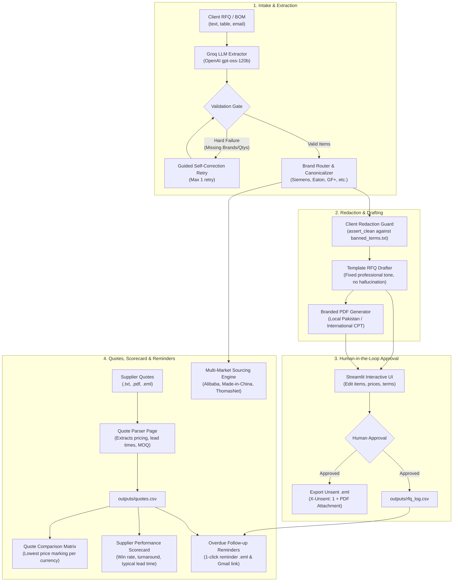

# Procurement Assistant (Agentic RFQ Drafting)

LangGraph + Groq assistant that turns a messy client request or BOM into supplier-ready RFQ emails.
A human reviews and approves every email. Nothing is ever sent automatically.

## Architecture & Workflow



### Design choices
- **Template emails, not free LLM text:** rules (never name end-clients) always hold. Text is redacted, then re-checked, and export is blocked if a restricted term remains, including terms typed in by hand during review.
- **Guided retry only for hard failures** (nothing extracted, or half the items lack brand/quantity). A missing part number alone is not retried, which protects the Groq free-tier token cap.
- **Rate-limit aware:** wait times are parsed from Groq errors; a wait over 90s (daily cap) stops cleanly.
- **Human approval required:** outgoing emails are strictly unsent `.eml` drafts with `X-Unsent: 1`. Nothing is ever sent over the network automatically.

## Quickstart & Setup

```bash
# 1. Install & configure
pip install -r requirements.txt
cp .env.example .env                                  # add GROQ_API_KEY
cp data/suppliers.example.csv data/suppliers.csv      # supplier contacts (multiple per brand)
cp data/banned_terms.example.txt data/banned_terms.txt# end-client names to redact

# 2. Daily workflows (via Makefile)
make run      # Starts Streamlit UI (app.py)
make test     # Runs all 134 offline unit tests
make smoke    # Verifies all 3 UI pages load cleanly
make eval     # Runs accuracy benchmark against test cases
```

`data/suppliers.csv`, `data/banned_terms.txt` and `data/company.json` are git-ignored on purpose (private business data).

## Comprehensive Documentation (`docs/`)

For in-depth technical specifications, architectural designs, security policies, and operations runbooks, see the dedicated documentation suite:

| Document | Focus |
|---|---|
| [01_EXECUTIVE_BRIEFING.md](file:///Users/pl/Desktop/PP/procurement-agent/docs/01_EXECUTIVE_BRIEFING.md) | High-level executive overview, business objectives, ROI, and core non-negotiable rules. |
| [02_ARCHITECTURE_AND_DATA_FLOW.md](file:///Users/pl/Desktop/PP/procurement-agent/docs/02_ARCHITECTURE_AND_DATA_FLOW.md) | LangGraph state machine, Pydantic schemas, brand routing, PDF generator, and IMAP subsystem. |
| [03_SECURITY_PRIVACY_AND_COMPLIANCE.md](file:///Users/pl/Desktop/PP/procurement-agent/docs/03_SECURITY_PRIVACY_AND_COMPLIANCE.md) | Client confidentiality regex engine, Incoterm sanitization, CSV formula defense, and file locking. |
| [04_OPERATIONS_AND_DEPLOYMENT.md](file:///Users/pl/Desktop/PP/procurement-agent/docs/04_OPERATIONS_AND_DEPLOYMENT.md) | System requirements, environment configuration, headless server execution, and disaster recovery. |
| [05_TESTING_AND_QUALITY_ASSURANCE.md](file:///Users/pl/Desktop/PP/procurement-agent/docs/05_TESTING_AND_QUALITY_ASSURANCE.md) | 134-test offline verification matrix, mock factories, edge-case coverage, and benchmark evaluation. |
| [06_ROADMAP_AND_TECH_DEBT.md](file:///Users/pl/Desktop/PP/procurement-agent/docs/06_ROADMAP_AND_TECH_DEBT.md) | Sprint velocity, architectural debt analysis, and future milestones (PostgreSQL, OCR, RBAC). |

## Files

| File | Purpose |
|---|---|
| `Makefile` | One-command shortcuts (`make run`, `make test`, `make smoke`, `make eval`) |
| `agent.py` | LangGraph graph (extract, validate, retry, draft) |
| `extractor.py` | Groq structured extraction + rate-limit backoff |
| `rfq_drafter.py` | Brand routing, RFQ template, redaction, guard |
| `validation.py` | Missing-field checks, retry rule |
| `suppliers.py` | Supplier CSV + brand aliases |
| `exporter.py` | Approved export (.eml, optional PDF attachment) + `outputs/rfq_log.csv`; reminder .eml builder |
| `rfq_pdf.py` | RFQ form PDF (letterhead, items table, terms), restricted-term guard on the final PDF |
| `app.py` | Streamlit UI: RFQ drafting |
| `pages/2_Quote_Parser.py` | Streamlit page: supplier replies to structured quotes |
| `quote_parser.py` | Quote extraction, validation, RFQ-reference matching |
| `quote_store.py` | `outputs/quotes.csv` store and RFQ log reader |
| `compare.py` | Line-by-line quote comparison, flags, overdue-reply reminders |
| `pages/3_Compare_Quotes.py` | Streamlit page: comparison table + waiting-for-reply list |
| `imap_checker.py` | IMAP inbox poller, reply matcher, and Streamlit caching integration |
| `tests/test_core.py` | Offline tests (fake LLM) |
| `tests/test_reminder.py` | 29 offline tests for reminder email builder |
| `tests/test_imap.py` | 28 offline tests for IMAP reply detection |

## Roadmap

| Sprint | Deliverable |
|---|---|
| 1 (done) | Extract, validate, draft, human approval, export |
| 1.1 (done) | Request-level fields (your RFQ no., delivery terms, deadline, country of origin, sales tax) carried into every supplier email; Schneider alias; gpt-oss default model |
| 2 (done) | Quote parser page: read supplier replies (.txt/.pdf/.eml) into prices, lead time, MOQ, validity, origin; checks totals; links to your RFQ; saves to `outputs/quotes.csv` after approval |
| 2.5 (done) | RFQ form PDF in house style (International / Local), attached to each approved email; company details in `data/company.json` |
| 3 (done) | Quote comparison table (per client RFQ, no currency conversion) + follow-up reminders for RFQs with no reply |
| 3.1 (done) | Multi-supplier per brand & Supplier history scorecard (win rate, turnaround time, typical lead times) |
| 3.2 (done) | Reminder .eml builder: "Generate Reminder .eml" button per overdue RFQ row; banned-term guard; Gmail draft link; 29 offline tests |
| 3.3 (done) | Supplier Web Search tab: 1-click search generation for Alibaba, Made-in-China, ThomasNet, and Google Industrial |
| 3.4 (done) | Live Webmail IMAP Subsystem: SSL inbox monitoring (`mail.abdullah-traders.com.pk:993`), supplier reply detection, sidebar badges & caching |
| 4 | Evaluation on real RFQs (time saved, extraction accuracy), deploy, README metrics & architecture diagram |
