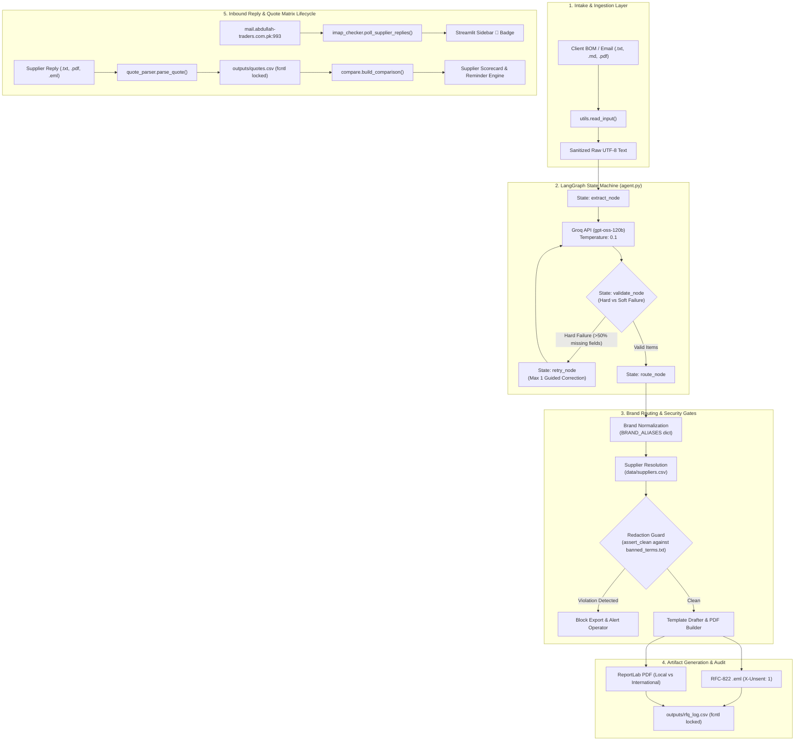

# Technical Architecture & Data Flow

**Document Class:** System Architecture Specification  
**Target Audience:** Chief Technology Officer / Lead Systems Architect  
**Core Technologies:** Python 3.14, Streamlit, LangGraph, Groq OSS LLM (`gpt-oss-120b`), ReportLab, IMAP4-SSL  

---

## 1. System Topology & Component Model

The system follows a modular, state-driven architecture built around a core LangGraph orchestration state machine, backed by Streamlit for UI presentation and POSIX file stores for persistence.



---

## 2. Core Modules & Responsibilities

| Module | File | Primary Responsibility |
|---|---|---|
| **Graph Orchestrator** | `agent.py` | StateGraph execution flow: `extract -> validate -> retry -> route -> draft`. |
| **LLM Extractor** | `extractor.py` | Prompt construction, Groq API client with token rate-limit backoff (`Retry-After`). |
| **Validation Gate** | `validation.py` | Pydantic schema validation; enforces rules distinguishing retriable hard errors from acceptable soft gaps. |
| **Data Schemas** | `schemas.py` | Strict Pydantic models: `LineItem`, `RFQDraft`, `ParsedQuote`, `QuoteLine`, `RFQMeta`. |
| **Brand & Supplier Routing** | `suppliers.py` | Maps raw OEM names (e.g., "GF Piping", "Georg Fischer") to canonical names and resolves multiple contacts. |
| **Confidentiality Engine** | `rfq_drafter.py` | Regex-based banned-term search and strict template-based RFQ composition. |
| **PDF Rendering Engine** | `rfq_pdf.py` | Custom ReportLab Flowable generator supporting Pakistani (NTN/STRN) and International (Incoterms 2020) formats. |
| **Audit & EML Exporter** | `exporter.py` | Writes MIME multipart emails with `X-Unsent: 1`, logs transactions with POSIX file locks. |
| **Quote Parser** | `quote_parser.py` | Ingests supplier pricing, lead times, MOQ, payment terms, and verifies arithmetic line-item totals. |
| **Comparison & Scoring** | `compare.py` | Matrix aggregation, lowest-price marking per currency, supplier turnaround & win-rate scoring. |
| **IMAP Poller** | `imap_checker.py` | SSL connection to port 993, scans recent messages by supplier email and RFQ ref, provides Streamlit caching. |

---

## 3. Data Schema & Representation

### 3.1 Line Item Entity (`schemas.LineItem`)
```python
class LineItem(BaseModel):
    description: str          # Normalized engineering description
    brand: str | None         # Resolved OEM brand name
    part_number: str | None   # Manufacturer part/model number
    quantity: int | None      # Quantity requested
    unit: str = "pcs"         # Unit of measure (pcs, m, set, etc.)
    specs: str | None         # Technical specifications / ratings
```

### 3.2 Quote Line Entity (`schemas.QuoteLine`)
```python
class QuoteLine(BaseModel):
    item_no: int              # Matching line item index
    description: str          # Quoted part description
    part_number: str | None   # Quoted part number
    quantity: float           # Quoted quantity
    unit: str                 # Quoted unit
    unit_price: float         # Unit price in declared currency
    total_price: float        # Line total price
    lead_time_days: int | None# Lead time in calendar days
    moq: int | None           # Minimum Order Quantity
    notes: str | None         # Deviations or exceptions
```

---

## 4. Multi-Brand Ingestion & Splitting Lifecycle

When an input document contains items across multiple manufacturers:
1. **Extraction:** The LLM produces a single unified array of `LineItem` instances.
2. **Canonicalization:** Each item's `brand` is passed to `suppliers.normalize_brand()` against `BRAND_ALIASES`.
3. **Partitioning:** Items are grouped into a dictionary `dict[brand, list[LineItem]]`. Unbranded items are grouped under `"Unbranded / Generic"`.
4. **Draft Resolution:** For each brand, the system queries `data/suppliers.csv`. If multiple supplier contacts exist for a brand, the user can select the target recipient or draft to all contacts.
5. **RFQ Numbering:** Distinct references are created using the pattern:
   `RFQ-<PROJECT_OR_SEQ>-<BRAND_SLUG>` (e.g. `RFQ-1326-SIEMENS`, `RFQ-1326-DANFOSS`).

---

## 5. Live IMAP Monitoring Architecture

To bridge the gap between offline drafting and supplier response tracking:
- **Connection Protocol:** IMAP4 over TLS/SSL on port 993 (host: `mail.abdullah-traders.com.pk`).
- **Target Mailbox:** `INBOX` (read-only mode to prevent altering server flags or accidental message deletion).
- **Matching Algorithm:**
  1. Compiles all active supplier emails from `data/suppliers.csv`.
  2. Compiles all logged RFQ references from `outputs/rfq_log.csv`.
  3. Executes targeted searches (`FROM <email>` and `SUBJECT <reference>`).
  4. Deduplicates message UIDs and parses message headers (`From`, `Subject`, `Date`).
- **UI Performance Caching:** Polling is cached via `@st.cache_data(ttl=120)` with automatic cache-busting upon manual user refresh, eliminating UI blocking during user interactions.
